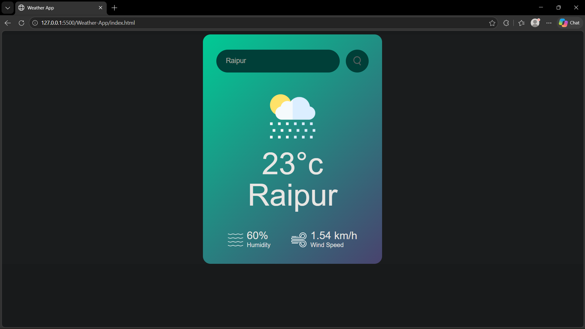

# Weather App 🌤️

A simple and responsive Weather Application that allows users to check real-time weather information of different cities.

## Features

- Search weather by city name
- Display current temperature
- Show humidity information
- Display wind speed
- Weather condition icons
- Dynamic weather information

## Technologies Used

- HTML5
- CSS3
- JavaScript
- Weather API

## Project Structure

Weather-App/

- index.html
- style.css
- images/

## How to Run

1. Clone this repository.
2. Open the project folder in VS Code.
3. Open index.html using Live Server.

## Author

Created by Jayanta

## Screenshot

